  

# 🌐 Awesome Interactive Simulation & Experimental AI 🤖

  
  
  
  
  
  
  

  <strong>A curated list of top interactive simulation platforms, agent-based modeling (ABM) engines, system dynamics tools, multi-agent reinforcement learning (MARL) sandboxes, and experimental AI physics environments.</strong>
   
  <em>Featuring enterprise cloud SaaS suites ranked by company scale alongside top-tier open-source tools ranked by community GitHub stars.</em>

---

## 📑 Table of Contents
- [📊 Sector Overview & Market Dynamics](#-sector-overview--market-dynamics)
- [☁️ SaaS & Hosted Platforms](#️-saas--hosted-platforms)
- [🛠️ Open-Source Equivalents & Tools](#️-open-source-equivalents--tools)
  - [🤖 Multi-Agent Systems, Generative Swarms & Social Sandboxes](#-multi-agent-systems-generative-swarms--social-sandboxes)
  - [🦾 Physics, Robotics & Embodied AI Simulators](#-physics-robotics--embodied-ai-simulators)
  - [🧠 Multi-Agent Reinforcement Learning (MARL) & Benchmarks](#-multi-agent-reinforcement-learning-marl--benchmarks)
  - [👥 Agent-Based Modeling (ABM) & Complex Adaptive Systems](#-agent-based-modeling-abm--complex-adaptive-systems)
  - [📈 System Dynamics & Discrete-Event Simulation Engines](#-system-dynamics--discrete-event-simulation-engines)
- [📈 Star History](#-star-history)
- [💖 Support](#-support)
- [🤝 Contributing](#-contributing)
- [📄 License](#-license)

---

## 📊 Sector Overview & Market Dynamics

The global simulation software and interactive AI modeling market is estimated at approximately **$12B–$15B** (projected to surpass **$30B+ by 2030** at an estimated CAGR of 13–15%), driven by surging demand for industrial digital twins, autonomous agents, and synthetic training environments. 

The sector remains **moderately to highly fragmented** rather than a winner-take-all landscape:
* **Industrial & Enterprise Domain:** Dominated by established simulation engineering and computing incumbents (e.g., Wolfram, AnyLogic, Minitab/Simul8, Siemens, Dassault) offering tailored, vertical-specific digital twin ecosystems.
* **Autonomous AI & Generative Agents Tier:** Experiencing intense unbundling and vibrant innovation between niche cloud platforms and hyper-active open-source research communities (such as DeepMind, Farama Foundation, Meta, and OpenAI-adjacent ecosystems) where high-fidelity simulation engines are increasingly open-sourced to fuel foundational AI training.

---

## ☁️ SaaS & Hosted Platforms

> [!NOTE]
> SaaS platforms are sorted in **descending order of estimated company size** (annual revenue / valuation standing).

| Platform | Company Size (Est. Revenue / Valuation) | Deployment / Delivery | Pricing (Specific Starting Tiers) | Free Tier Limits / Free Trial Terms |
| :--- | :--- | :--- | :--- | :--- |
| **[Wolfram SystemModeler](https://wolfram.com)** | **~$70M–$150M+ annual revenue** (~500–800 employees; privately held) | Desktop + Wolfram Cloud | **$350/year** (Personal/Standard desktop/cloud tier) or **$3,495** one-time perpetual license | **30-day full-feature free trial**; Wolfram Cloud Basic tier is free forever but capped at **0.2 CPU hours/month** and **200 MB storage** |
| **[AnyLogic Cloud](https://anylogic.com)** | **~$23M–$26M annual revenue** (~100–150 employees; bootstrapped/private) | Multi-tenant SaaS & Private Cloud | **~$2,500/year** per user (Professional Cloud Subscription starting quote) | **Free forever plan**: Public model hosting only; compute capped at **1 minute** for standard runs, **5 minutes** for animated/optimization runs, **2 GB RAM**, and **32 MB** output file limits |
| **[Simul8](https://simul8.com)** | **~$5M–$10M annual revenue** (Acquired by Minitab, LLC in Dec 2024; estimated $100M+ parent group) | Cloud SaaS & Windows Desktop | **$4,999/user/year** (Simul8 Basic / Professional named annual license) | **14-day free trial** with full access to cloud modeling features; no permanent free tier |
| **[Simio Cloud](https://simio.com)** | **~$5.9M–$7.3M annual revenue** (~50 employees; acquired by Aegis Industrial Software) | Cloud SaaS & On-Premises Digital Twin | **~$5,000/seat/year** (Starting commercial digital twin seat subscription) | **30-day fully functional free evaluation trial**; completely free 100% feature-unlocked licenses for accredited university academic programs |
| **[Vensim Cloud / Forio Epicenter](https://vensim.com)** | **~$1.8M–$3.2M annual revenue** (Ventana Systems & Forio joint cloud platform) | Cloud Platform API & Desktop Engine | **$50 one-time** (Vensim PLE commercial) or **$100/month** (Forio Epicenter Team Cloud tier) | **Free forever tier**: Vensim PLE is free for educational and personal academic use; Forio Epicenter free developer account allows up to **3 public projects** and **10 MB storage** |
| **[Stella Online (isee systems)](https://iseesystems.com)** | **~$450K–$1M annual revenue** (~10–20 employees; specialized private SMB) | Web SaaS (isee Exchange) | **$509 one-time** (Stella Architect individual desktop + linked cloud publishing license) | **Free forever browser plan**: Limited strictly to **3 stocks** and **20 total model icons** for basic causal loops and educational learning |
| **[NetLogo Web](https://netlogoweb.org)** | **Non-Profit / Research-Backed** (Center for Connected Learning & Northwestern Univ.) | Hosted Browser Application | **$0 / Free** (Open educational access, NSF-supported) | **Free forever without restrictions**: Runs entirely client-side via JavaScript engine; exportable to local desktop NetLogo |
| **[Insight Maker](https://insightmaker.com)** | **Non-Profit / Open-Access** (Open-source community & donation funded) | Cloud-Hosted Web Application | **$0 / Free** (100% free web-based modeling platform) | **Free forever without limits**: Unlimited public simulation models, unlimited simulation runs, multi-user real-time collaboration |

---

## 🛠️ Open-Source Equivalents & Tools

> [!TIP]
> Open-source repositories in each category are sorted in **descending order of GitHub Star count**. Each star badge links directly to the project's real-time stargazers.

### 🤖 Multi-Agent Systems, Generative Swarms & Social Sandboxes

* **[MetaGPT](https://github.com/geekan/MetaGPT)**  — Multi-agent framework that assigns diverse roles (product managers, architects, engineers) to LLMs to simulate collaborative software companies and complex workflows.
* **[ChatDev](https://github.com/OpenBMB/ChatDev)**  — Virtual software company simulator where communicative multi-agent systems collaborate through interactive chat chains to design and develop software.
* **[Generative Agents](https://github.com/joonspk-research/generative_agents)**  — The canonical computational sandbox simulating 25 generative LLM agents living in an interactive virtual town (*Smallville*) with emergent social dynamics.
* **[Swarms](https://github.com/kyegomez/swarms)**  — Enterprise-grade production multi-agent orchestration framework for simulating and executing swarms of autonomous communicative agents.
* **[Concordia](https://github.com/google-deepmind/concordia)**  — DeepMind's generative agent-based social simulation library powered by language models for studying social contracts and collective human-AI behavior.

### 🦾 Physics, Robotics & Embodied AI Simulators

* **[Genesis](https://github.com/Genesis-Embodied-AI/Genesis)**  — Ultra-fast, universal physics simulation platform for robotics, embodied AI, and tactile sensing, simulating rigid bodies, fluids, deformable solids, and muscle actuators.
* **[AirSim](https://github.com/microsoft/AirSim)**  — Microsoft's open-source simulator for autonomous drones, cars, and mobile robots built on Unreal Engine for physically and visually realistic AI experiments.
* **[MuJoCo](https://github.com/google-deepmind/mujoco)**  — Google DeepMind's multi-joint dynamics with contact engine; the gold standard physics simulator for reinforcement learning, biomechanics, and robotic manipulation.
* **[PyBullet](https://github.com/bulletphysics/bullet3)**  — Easy-to-use Python SDK for Bullet Physics, widely utilized for robotics research, virtual reality, multi-joint inverse kinematics, and reinforcement learning.
* **[CARLA](https://github.com/carla-simulator/carla)**  — Open-source urban driving simulator developed from the ground up to support development, training, and validation of autonomous driving systems and sensor fleets.
* **[Isaac Lab](https://github.com/isaac-sim/IsaacLab)**  — Unified modular simulation framework by NVIDIA built on Omniverse Isaac Sim for robot learning, whole-body loco-manipulation, and high-fidelity GPU physics.
* **[NVIDIA Warp](https://github.com/NVIDIA/warp)**  — High-performance Python framework for writing GPU-accelerated simulation kernels, spatial computing algorithms, and differentiable physical systems.
* **[Webots](https://github.com/cyberbotics/webots)**  — Award-winning, open-source 3D robot simulation suite providing a comprehensive development environment for modeling industrial and wheeled robots.
* **[Habitat-Sim](https://github.com/facebookresearch/habitat-sim)**  — Meta AI's high-performance 3D simulator rendering photorealistic indoor spaces at thousands of frames per second for embodied AI agents.
* **[Habitat-Lab](https://github.com/facebookresearch/habitat-lab)**  — Modular high-level library for training embodied AI agents (PointGoal navigation, rearrangement, visual question answering) in Habitat.
* **[IsaacGymEnvs](https://github.com/isaac-sim/IsaacGymEnvs)**  — End-to-end GPU-accelerated simulation environments running directly in tensor memory for extreme RL throughput.
* **[AI2-THOR](https://github.com/allenai/ai2thor)**  — Near-photorealistic interactive environment for embodied AI containing hundreds of physics-enabled rooms with actionable household objects.
* **[Gazebo](https://github.com/gazebosim/gz-sim)**  — The premier open-source multi-robot 3D simulator featuring high-fidelity sensor models, multiple physics backends (DART, Bullet), and seamless ROS 2 integration.

### 🧠 Multi-Agent Reinforcement Learning (MARL) & Benchmarks

* **[Gymnasium](https://github.com/Farama-Foundation/Gymnasium)**  — The standard open-source Python API interface for single-agent reinforcement learning and experimental control tasks (official maintained successor to OpenAI Gym).
* **[PettingZoo](https://github.com/Farama-Foundation/PettingZoo)**  — The universal multi-agent standard interface providing multi-agent Atari, classical, particle, and cooperation games with Gymnasium compatibility.
* **[ManiSkill](https://github.com/haosulab/ManiSkill)**  — Benchmark environment for robot manipulation powered by GPU parallelized physics engines supporting thousands of parallel environment instances.
* **[Brax](https://github.com/google/brax)**  — Google's fully differentiable 3D physics engine and benchmark environment written in JAX, allowing end-to-end policy gradients and million-step-per-second RL simulations.
* **[SMAC](https://github.com/oxwhirl/smac)**  — StarCraft Multi-Agent Challenge; Oxford WhiRL's standard benchmark environment for cooperative multi-agent reinforcement learning based on StarCraft II.
* **[Melting Pot](https://github.com/google-deepmind/meltingpot)**  — DeepMind's suite of multi-agent reinforcement learning substrate games focusing on social dilemmas, reciprocal altruism, and norm emergence.
* **[JaxMARL](https://github.com/bold-lab-ai/JaxMARL)**  — Fully GPU-vectorized multi-agent reinforcement learning library in JAX including multi-agent Hanabi, Overcooked, and StarCraft micro environments.
* **[Craftax](https://github.com/MichaelTMatthews/Craftax)**  — Ultra-fast Crafter-like survival and open-ended exploration environment written entirely in JAX for lightning-speed reinforcement learning research.

### 👥 Agent-Based Modeling (ABM) & Complex Adaptive Systems

* **[Mesa](https://github.com/projectmesa/mesa)**  — Python's premier modular framework for agent-based modeling, featuring scheduling systems, spatial 2D/continuous grids, and browser visualization.
* **[NetLogo](https://github.com/NetLogo/NetLogo)**  — The classic multi-agent programmable modeling environment for simulating natural, social, and economic phenomena with thousands of published models.
* **[Agents.jl](https://github.com/JuliaDynamics/Agents.jl)**  — High-performance, pure Julia agent-based modeling package built on top of the Julia dynamical systems ecosystem with interactive Makie visualization.
* **[AgentPy](https://github.com/JoelForamitti/agentpy)**  — Open-source Python library for developing, simulating, and analyzing agent-based models tailored specifically for Jupyter notebooks.
* **[MASON](https://github.com/eclab/mason)**  — Fast discrete-event multi-agent simulation core in Java designed to support massive-scale swarms, GIS extensions, and 3D visualization.
* **[FLAME GPU 2](https://github.com/FLAMEGPU/FLAMEGPU2)**  — Massive-scale GPU-accelerated agent-based simulation framework delivering real-time performance on CUDA-enabled computing clusters.
* **[GAMA Platform](https://github.com/gama-platform/gama)**  — Spatially explicit multi-agent simulation environment tailored for complex GIS modeling, environmental policy, and urban planning.
* **[Repast4Py](https://github.com/Repast/repast4py)**  — Next-generation Python agent-based modeling and simulation platform built with MPI for extreme high-performance computing (HPC) clusters.

### 📈 System Dynamics & Discrete-Event Simulation Engines

* **[OpenModelica](https://github.com/OpenModelica/OpenModelica)**  — Open-source Modelica-based modeling and simulation environment for cyber-physical systems, serving as the leading FOSS alternative to Wolfram SystemModeler.
* **[PySD](https://github.com/JamesPHoughton/pysd)**  — Python library that compiles Vensim and XMILE/Stella system dynamics models directly into native Python for integration with modern data science stacks.
* **[Salabim](https://github.com/salabim/salabim)**  — Discrete-event simulation package in Python featuring built-in 2D/3D real-time graphical animation, queueing statistics, and queue monitor trackers.
* **[BPTK-Py](https://github.com/transentis/bptk_py)**  — The Business Prototyping Toolkit for Python; unifies System Dynamics and Agent-Based Modeling with interactive dashboards.

---

## 📈 Star History

---

## 💖 Support

Thank you for visiting and exploring **Awesome Interactive Simulation & Experimental AI**! 🌟

If you found this resource helpful for your research, projects, or simulations:
- ⭐ **Star** this repository on GitHub to help others discover it.
- 🍴 **Fork** it to test models or contribute your own simulation frameworks.
- 📢 **Share** it with fellow researchers, roboticists, and AI developers.
- ☕ **Sponsor & Buy a Coffee:** Support ongoing maintenance via the [GitHub Sponsor Dashboard](https://github.com/sponsors/ishandutta2007).

---

## 🤝 Contributing

Contributions are very welcome! Please follow these guidelines:
1. Ensure the simulator or engine is actively maintained or represents a seminal tool in the field.
2. Place the repository in the appropriate category, keep the description concise, and include its social star badge.
3. Submit a Pull Request with a clear summary of the additions.

---

## 📄 License

This compilation is shared under the [CC0 1.0 Universal License](LICENSE).
